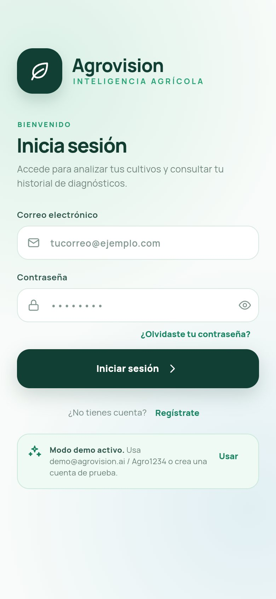
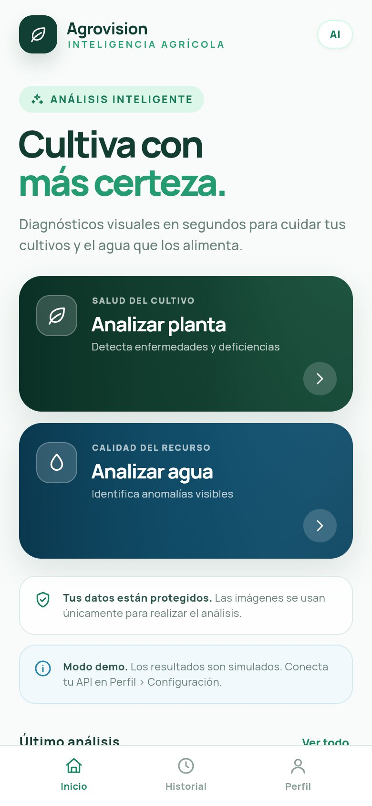
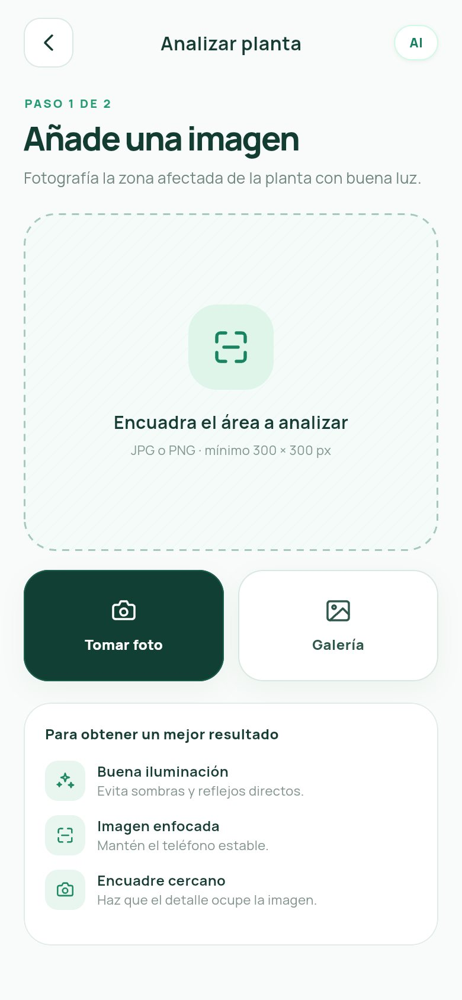
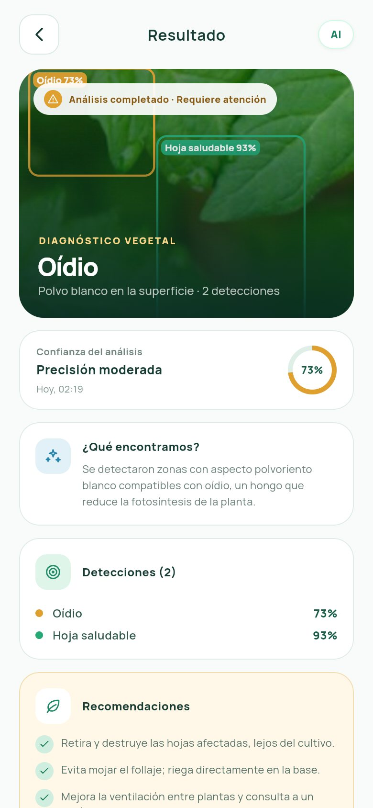
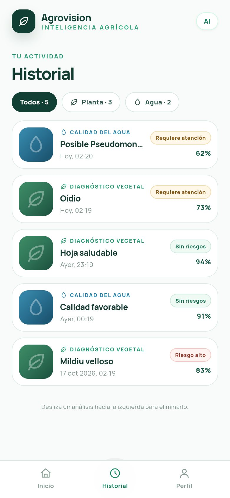
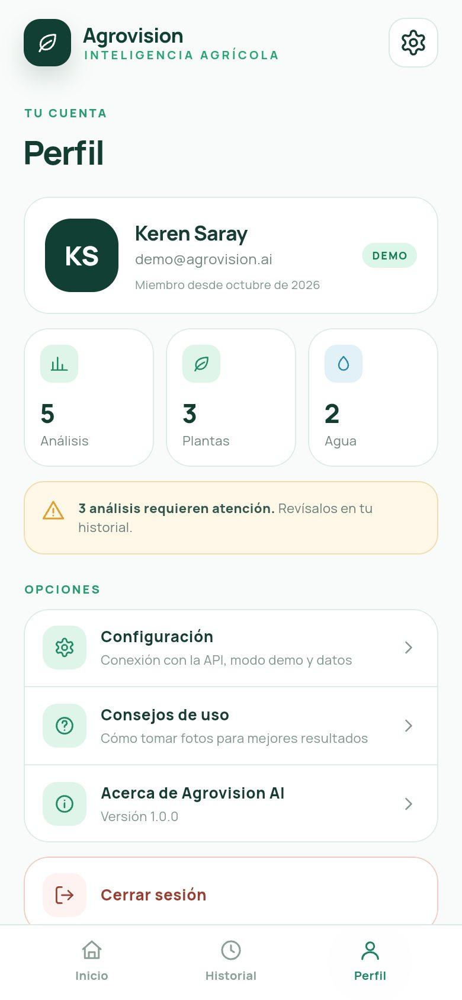

# Agrovision AI · App móvil (Flutter)

Frontend móvil para analizar **plantas** (pepino, YOLOv11) y la **calidad del agua**
(bacterias, EfficientNet-B0). Está basado en el diseño de Figma *Agrovision AI Mobile App*
y preparado para conectarse con la API FastAPI de `API REST/Bacteria_multitask/main.py`.

Hoy funciona **100 % con datos simulados (mock)**. Para pasar a la API real no hay que tocar
ninguna pantalla: se cambia un interruptor en **Perfil › Configuración**, o un `--dart-define`
al compilar.

| Login | Inicio | Captura | Resultado | Historial | Perfil |
|---|---|---|---|---|---|
|  |  |  |  |  |  |

Todas las capturas están en [`docs/capturas/`](docs/capturas).

---

## 1. Ejecutar la app

Requisitos: Flutter con Dart 3.13.4 o superior (la misma versión con la que se creó el proyecto; se probó con Flutter 3.47.7) y un emulador o celular Android/iOS.

```bash
flutter pub get
flutter run
```

**Cuenta demo:** `demo@agrovision.ai` / `Agro1234`. En el login también está el botón **"Usar"**,
que rellena estos datos. Esta cuenta trae 3 análisis de ejemplo en el historial. También puedes
crear cuentas nuevas en *Regístrate*; quedan guardadas en el teléfono.

Pruebas automáticas:

```bash
flutter analyze   # sin advertencias
flutter test      # 18 pruebas: contrato de la API, validación de imágenes y flujos de pantallas
```

---

## 2. Pantallas

| # | Pantalla | Archivo |
|---|---|---|
| 1 | Splash (recupera la sesión guardada) | `lib/screens/splash.dart` |
| 2 | Iniciar sesión | `lib/screens/auth/inicio_sesion.dart` |
| 3 | Registro | `lib/screens/auth/registro.dart` |
| 4 | Recuperar contraseña | `lib/screens/auth/recuperar_contrasena.dart` |
| 5 | Inicio (planta / agua) | `lib/screens/pantalla_inicio.dart` |
| 6 | Captura de imagen (cámara / galería) · paso 1 de 2 | `lib/screens/captura_imagen.dart` |
| 7 | Validación de imagen (vista previa) · paso 2 de 2 | `lib/screens/validacion_imagen.dart` |
| 8 | Procesando análisis | `lib/screens/procesando_analisis.dart` |
| 9 | Resultados (con cajas de detección de YOLO) | `lib/screens/resultados_analisis.dart` |
| 10 | Historial (filtros, eliminar deslizando) | `lib/screens/historial.dart` |
| 11 | Perfil (estadísticas, consejos, cerrar sesión) | `lib/screens/perfil.dart` |
| 12 | Configuración (mock/API, URL, parámetros, datos) | `lib/screens/configuracion.dart` |

La barra inferior (Inicio · Historial · Perfil) vive en `lib/screens/navegacion_principal.dart`.

Reglas de validación de imagen, iguales a las del diseño y del backend: **JPG o PNG**,
**mínimo 300 × 300 px** y **máximo 10 MB**. Antes de enviarse, la foto se reduce a un máximo de 2048 px.

---

## 3. Estructura del código

```
lib/
├── main.dart                     # Arranque: crea AppServices y lanza la app
├── app.dart                      # MaterialApp + Providers
├── core/
│   ├── config/app_config.dart    # ⚙️ URL por defecto, modo mock, límites, cuenta demo
│   ├── routes/app_routes.dart    # Rutas con nombre y sus argumentos
│   ├── theme/                    # Colores y tipografía del Figma (fuente Manrope)
│   ├── errors/app_exception.dart # Errores con mensaje listo para el usuario
│   └── utils/                    # Validación de imagen, cámara/galería, formatos
├── data/
│   ├── models/
│   │   ├── api_responses.dart    # 🔌 Respuestas EXACTAS de la API FastAPI
│   │   ├── analysis_result.dart  # Resultado interpretado (lo que ve la UI)
│   │   ├── analysis_type.dart    # planta → /predict/cucumber · agua → /predict/bacteria
│   │   └── user.dart
│   ├── interpreters/
│   │   ├── diagnosis_catalog.dart  # 📝 Textos por cada clase del modelo (editar aquí)
│   │   └── result_interpreter.dart # JSON de la API → AnalysisResult
│   ├── repositories/             # Interfaces + implementaciones Mock y Api
│   ├── services/                 # Cliente HTTP, sesión, fotos guardadas
│   └── mock/mock_data.dart       # Datos quemados (mismo formato que la API)
├── state/
│   ├── app_services.dart         # 🔀 ÚNICO lugar donde se elige mock o API
│   ├── auth_controller.dart
│   ├── history_controller.dart
│   └── settings_controller.dart
├── screens/                      # Pantallas
└── widgets/                      # Componentes del diseño (tarjetas, botones, íconos…)
```

### Por qué cambiar a la API no complica nada

```
Pantalla ──► AppServices.analysis ──► AnalysisRepository (interfaz)
                                        ├── MockAnalysisRepository  → genera el JSON de la API
                                        └── ApiAnalysisRepository   → llama a la API real
                                                     │
                         ambos usan el mismo fromJson + ResultInterpreter
```

El mock no devuelve objetos "inventados". Genera **el mismo JSON** que devuelve FastAPI y lo pasa
por el mismo código de parseo que se usa con la API real. Si algo funciona con el mock, funciona igual con la API.

---

## 4. Conectar con tu API FastAPI

1. **Arranca la API** con acceso desde la red:
   ```bash
   cd "API REST/Bacteria_multitask"
   uvicorn main:app --host 0.0.0.0 --port 8000
   ```
2. En la app ve a **Perfil › Configuración** y:
   - Apaga **"Análisis de prueba"**.
   - En **URL base de la API** escribe:
     - Emulador de Android: `http://10.0.2.2:8000` (valor por defecto).
     - Celular físico: `http://IP-DE-TU-PC:8000`, por ejemplo `http://192.168.1.50:8000`.
       El celular y el PC deben estar en la misma red Wi-Fi.
   - Pulsa **Probar conexión**. Debe aparecer "Conexión exitosa" con los dos modelos *Cargado*.
3. Analiza una imagen. Los resultados reales no muestran la nota "Resultado simulado".

También se puede fijar desde la compilación, sin tocar la pantalla:

```bash
flutter run \
  --dart-define=USE_MOCK_ANALYSIS=false \
  --dart-define=API_BASE_URL=http://192.168.1.50:8000
```

> **HTTP en desarrollo.** Para usar `http://` (sin la "s"), se habilitó el tráfico sin cifrar:
> `android:usesCleartextTraffic="true"` en `AndroidManifest.xml` y `NSAllowsArbitraryLoads` en
> `ios/Runner/Info.plist`. Cuando publiques la API con `https://`, quítalos.

### Contrato que usa la app

| Endpoint | Envío | Respuesta | Estado |
|---|---|---|---|
| `GET /` | — | `{message, models_loaded: {yolo_cucumber, efficientnet_bacteria}}` | ✅ existe |
| `POST /predict/cucumber?conf=0.25&iou=0.45` | `multipart/form-data`, campo `file` | `{success, image_width, image_height, total_detections, detections: [{class_id, class_name, confidence, bbox: {x1,y1,x2,y2}}]}` | ✅ existe |
| `POST /predict/bacteria` | `multipart/form-data`, campo `file` | `{success, predicted_class, confidence}` | ✅ existe |
| `POST /auth/login` | JSON `{email, password}` | `{access_token, token_type, user: {id, name, email, created_at}}` | ⏳ pendiente en backend |
| `POST /auth/register` | JSON `{name, email, password}` | igual que login | ⏳ pendiente |
| `POST /auth/forgot-password` | JSON `{email}` | `{message}` | ⏳ pendiente |
| `POST /auth/logout` | header `Authorization: Bearer <token>` | `{message}` | ⏳ pendiente (opcional) |

Los errores se leen en el formato estándar de FastAPI, `{"detail": "..."}`, y se muestran tal cual al usuario.
Cuando haya sesión, todas las peticiones envían `Authorization: Bearer <token>`.

**Login:** mientras el backend no tenga `/auth/*`, deja encendido **"Login de prueba"**. Cuando
implementes esos endpoints con el formato de la tabla, apágalo. Esa parte está en
`lib/data/repositories/api_auth_repository.dart`.

### Ajustar los textos a las clases reales de tus modelos

Los archivos `model/config/classes.json` y los nombres de clase del YOLO no están en el repositorio,
así que el catálogo trae nombres comunes (`healthy`, `downy_mildew`, `powdery_mildew`, `E_coli`,
`coliformes`, `sin_bacterias`, …). Abre `lib/data/interpreters/diagnosis_catalog.dart` y agrega o
renombra las claves para que coincidan con tus clases.

- La comparación ignora mayúsculas y separadores: `"Downy Mildew"` equivale a `downy_mildew`.
- Si llega una clase que no está en el catálogo, la app **no se rompe**: muestra el nombre de la
  clase con un texto genérico.

---

## 5. Observaciones sobre el backend (no se modificó)

- A `Requirements.txt` le faltan paquetes que `main.py` importa: **`ultralytics`**, **`numpy`** y
  **`onnxruntime`** (este último para cargar el `.onnx`).
- Los modelos (`model/*.onnx`, `model/*.pt`, `model/config/*.json`) no están en el repositorio. Sin
  ellos, `GET /` indica *No cargado* y los endpoints de predicción responden error 500. La app
  muestra ese mensaje con opción de reintentar.

## 6. Cambios respecto al proyecto original

- Se corrigió `pubspec.yaml`: `image_picker` estaba mal indentado y el proyecto no instalaba dependencias.
- Se reemplazó el test de ejemplo del contador, que no compilaba, por 18 pruebas reales.
- El proyecto pasó de `flutter_application_1` a `agrovision_ai`, con id `com.agrovision.ai` en Android e iOS.
- Se añadieron los permisos de cámara y galería en iOS y el permiso de internet en Android.
- Se incluyó la fuente Manrope en `assets/fonts` para que la app no dependa de internet.
## 7. Base de datos

El script [`database/agrovision_db.sql`](database/agrovision_db.sql) crea la base de datos
`agrovision_db` (MariaDB 10.2.1 o superior; probado con la 13.x). Aún no está conectada
a la API: es la base para implementar `/auth/*` y guardar el historial en el servidor
(ver sección 7).

| Tabla | Descripción |
|---|---|
| `usuarios` | Perfiles de usuario (nombre, correo y hash de la contraseña) |
| `modelos` | Ficha mínima de cada modelo de ML: versión, formato, dataset y licencia |
| `analisis` | Historial: tipo (planta/agua), estado, imagen y fecha. El usuario es opcional |
| `predicciones` | Resultados de los modelos: una fila por clase o por detección |
| `interpretaciones_recomendaciones` | Explicación y recomendaciones que se muestran al usuario |

La vista `vista_historial` une todo para la pantalla Historial.

### Cómo se guardan los resultados

- **Plantas (YOLO):** cada detección es una fila en `predicciones`, con su clase, su
  confianza y la caja (`bbox_x1`, `bbox_y1`, `bbox_x2`, `bbox_y2`). Una imagen puede
  tener varias detecciones.
- **Agua (EfficientNet):** una fila en `predicciones` con la clase predicha y su confianza,
  sin caja.
- **Confianza:** se guarda como porcentaje de 0 a 100. Si la API devuelve un valor entre
  0 y 1, el backend debe multiplicarlo por 100 antes de insertarlo.
- **Estado del análisis:** `completado`, `no_concluyente` (confianza insuficiente) o `error`.
- **Imágenes:** `imagen_path` es opcional y `imagen_eliminada_en` registra cuándo se
  borró la imagen, para poder aplicar una política de retención.
- **Clases:** no están fijadas en la base de datos, porque dependen del dataset y de los
  modelos, que aún están por definir. La tabla `modelos` permite registrar su
  procedencia y su versión cuando estén disponibles.

### Uso

Ejecutar el script completo en MySQL Workbench, o desde la terminal:

    mariadb -u usuario -p < database/agrovision_db.sql

Si ya existe una versión anterior de la base de datos y no hay datos que conservar,
ejecutar antes `DROP DATABASE IF EXISTS agrovision_db;`.
## 8. Próximos pasos sugeridos

- Implementar `/auth/*` en FastAPI (por ejemplo con JWT) y apagar "Login de prueba".
- Si quieres el historial en el servidor, crear `GET /history` y una implementación nueva de
  `HistoryRepository`. Hoy se guarda en el teléfono.
- Antes de publicar: ícono de la app, firma de release en Android y quitar el tráfico `http://`.
